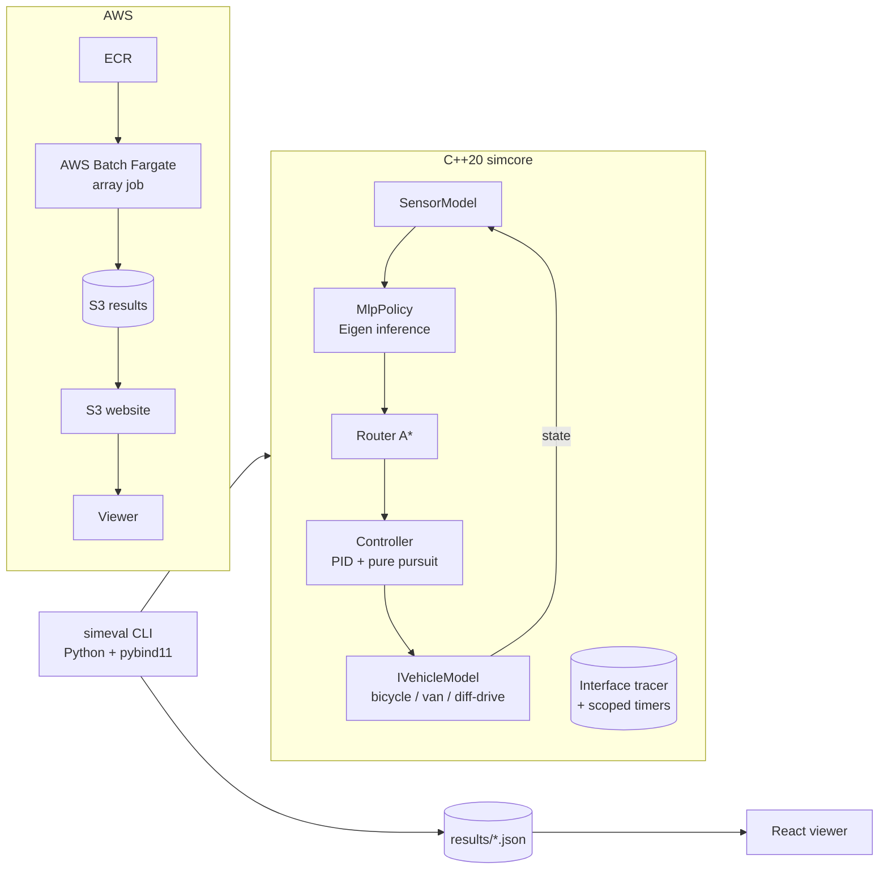

# Drive Sim Eval

[](https://github.com/mini4141/drive-sim-eval/actions/workflows/ci.yml)

A deterministic open-loop and closed-loop driving simulator with a large-scale evaluation pipeline. A C++20 core runs a learned policy through sensors → inference → routing → control → vehicle dynamics at a fixed 0.05 s timestep. Python drives batch evaluation at scale, proves bit-for-bit reproducibility, finds where a simulated run diverges from an on-road log, and profiles every component. A React viewer shows the results, and the same container fans out over AWS Batch.

Built as a portfolio project for a Core Simulation engineering role (autonomous driving, modern C++ and Python).

- Proof of every claim (screenshots, logs, test reports): [proof/README.md](proof/README.md)
- Write-up with architecture, stack table, costs and lessons: [docs/PORTFOLIO.md](docs/PORTFOLIO.md)

## Architecture



Open-loop and closed-loop are one engine: the pipeline config (`configs/*.yaml`) decides which components run (`vehicle: log_replay` replays the on-road states; `controller: log_replay` replays the on-road commands for divergence tracing).

## Quickstart (Windows 11 + Docker Desktop, Git Bash)

Prerequisites: Docker Desktop, Git, Node.js 24, uv. The C++ toolchain lives in the Docker build image.

```bash
scripts/dev-up.sh        # build core in Docker, generate 200 scenarios, run batch/diff/profile/repro, start viewer
# open http://localhost:5173
scripts/dev-down.sh
scripts/test-all.sh      # ctest + ruff + pytest + vitest + playwright
scripts/capture-proof.sh phase1
```

The CLI (run through the dev image by `scripts/lib.sh`, or directly where the wheel is installed):

```bash
simeval gen-scenarios --n 200 --seed 42 --out scenarios/
simeval run --scenario scenarios/s0002.json --config configs/closed_loop.yaml --platform car
simeval batch --scenarios scenarios/ --config configs/open_loop.yaml --workers 8 --batch-id local-001
simeval bench-scaling --batch-id local-001
simeval repro-check --scenario s0002 --repeats 5 --workers 1,4
simeval diff --onroad s0002 --platform van --inject sensor_dropout@tick=40
simeval profile --run results/demo/s0002_car_closed_loop.json
```

## Deploy to AWS and destroy

Uses the `drive-sim-eval-deployer` AWS profile, region `ap-southeast-2`. Everything is Terraform in `infra/`; GitHub Actions never holds AWS credentials.

```bash
scripts/deploy.sh                 # terraform apply, push image, 20-child Batch array job, aggregate job, publish viewer
scripts/capture-proof.sh phase2
scripts/destroy.sh                # cancel jobs, delete queue/CE, empty buckets, terraform destroy
scripts/verify-destroyed.sh       # exits non-zero if anything billable remains
```

## Layout

```
core/       C++20 library (include/, src/, tests/), CMakeLists.txt, CMakePresets.json
bindings/   pybind11 module -> simcore
simeval/    Python package: cli, batch, repro, diff, profile, scenarios, cloud
tools/      train_policy.py, policy_weights.json (committed)
configs/    open_loop.yaml, closed_loop.yaml, diff.yaml, platforms/*.yaml
viewer/     React 19 + Vite + Recharts app (reads results/**)
infra/      Terraform (VPC, ECR, S3 website, Batch, IAM)
docker/     multi-stage Dockerfile
scripts/    dev-up, test-all, seed, capture-proof, deploy, destroy, verify-destroyed
docs/       DECISIONS.md, AI_USAGE.md, PORTFOLIO.md
proof/      screenshots, logs, test reports for each phase
```
