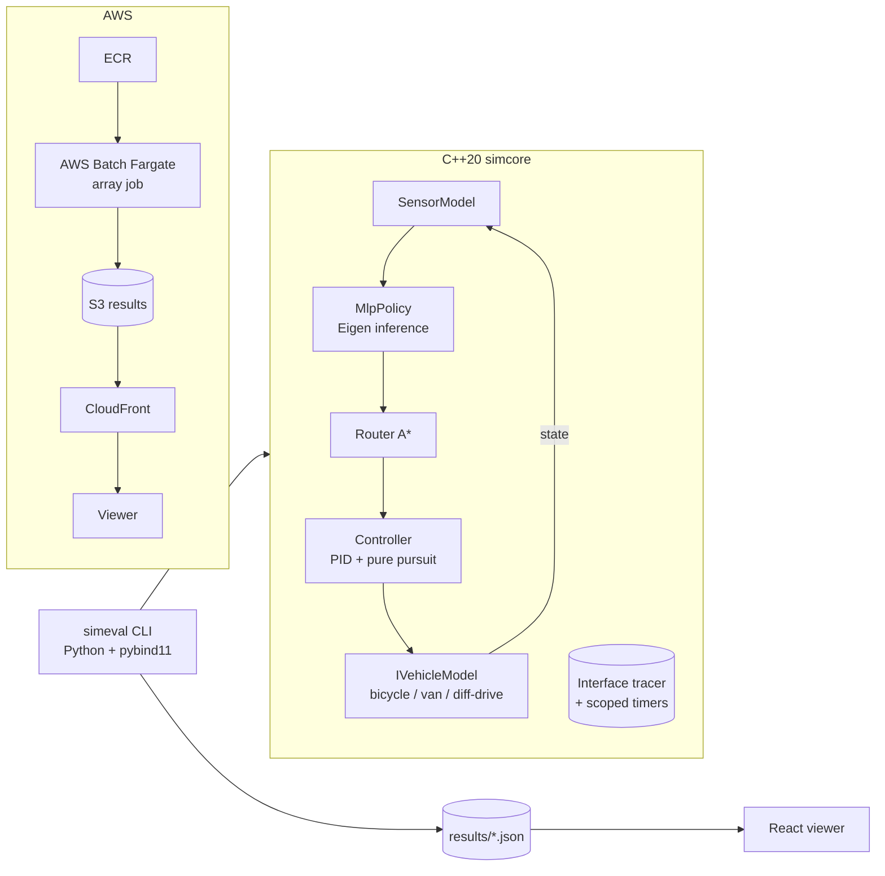

# SPECS.md: Drive Sim Eval

## 1. Summary

Drive Sim Eval is a small but realistic simulator for an **end-to-end learned driving stack**. A C++20 engine runs this loop at a fixed timestep:

sensor observations → MLP policy inference → routing → control → vehicle dynamics

It runs in two modes from one shared codebase:

- **Open-loop:** replay recorded ego states from a log, and score the policy's actions against the logged actions.
- **Closed-loop:** the policy actually drives the vehicle.

Python bindings power a CLI that does four things: runs large batches of open-loop evaluations, checks reproducibility, traces where a simulated run diverges from an "on-road" log, and profiles each component. A React viewer turns the results into pages a reviewer can click through. In the cloud, the same container fans out over AWS Batch.

**Demo story:**
1. Generate 200 scenarios and run them as a batch, locally or on AWS Batch.
2. Open the viewer and drill into one run's replay.
3. Prove that two runs are bit-identical.
4. Show the first interface where the sim run diverges from the on-road log.
5. Show where the time goes in each component.

## 2. Requirement coverage matrix

| Requirement (from the job post) | Where it's covered | Proof |
|---|---|---|
| Modern C++ and Python in a shared simulation codebase | `core/` (C++20) + `simeval/` (Python) via pybind11 | ctest + pytest reports |
| Integrate driving-stack components, simulated robot systems, new vehicle platforms | `IVehicleModel` with `KinematicBicycle` (car), `KinematicBicycle` + actuator latency (van platform) and `DiffDrive` (delivery robot) | Viewer run pages for all 3 platforms |
| Support different simulation configs, focus on high-scale open-loop | Pipeline configs `configs/open_loop.yaml` and `configs/closed_loop.yaml`, plus the batch runner | Batch of 200 open-loop runs |
| Investigate on-road vs simulated differences across interfaces, data flow, timing, config | F4 divergence tracer: per-interface trace records, first-diverging interface | Diff page screenshot |
| Automated testing, observability, reproducibility, reliability, tooling | Tests, JSON logs, interface traces, F3 repro-check, CLI | Test reports, repro page |
| Profile workloads, performance and scalability | F5 profiler (Chrome trace + summary), worker scaling benchmark | Profile page, scaling table |
| Debugging complex systems: timing and failure modes | Injected faults: sensor dropout and actuator latency, visible in traces | Diff page |
| GenAI dev tools with careful review | `docs/AI_USAGE.md` | Doc |

## 3. Architecture



The main components:

| Component | What it does |
|---|---|
| `SensorModel` | Builds the observation vector from world state: lateral offset to the lane centre, heading error, curvature ahead, distance and relative speed of the nearest actor, current speed. It supports an injected dropout fault. |
| `MlpPolicy` | A 2-layer MLP: 8 inputs → 32 → 2 outputs (target curvature, target speed). |
| `Router` | A* over the lane graph, producing a route polyline. |
| `Controller` | Turns the policy output into steer and throttle/brake commands with PID. |
| `IVehicleModel` | Integrates state. Each platform has its own parameters: wheelbase, steering limit, max acceleration and actuator latency (in steps). |
| Interface tracer | Records `(tick, component, inputs_hash, outputs)` at every boundary. |

## 4. Repository layout

```
core/            C++ library (include/, src/, tests/), CMakeLists.txt, CMakePresets.json
bindings/        pybind11 module -> simcore
simeval/         Python package: cli.py, batch.py, repro.py, diff.py, profile.py, scenarios.py
tools/           train_policy.py, policy_weights.json (committed)
configs/         open_loop.yaml, closed_loop.yaml, platforms/*.yaml
viewer/          React + Vite app (reads results/**)
infra/           Terraform (vpc-lite public subnets, ecr, s3, batch, cloudfront, iam)
docker/          Dockerfile (multi-stage)
scripts/         dev-up.sh, build-core.sh, test-all.sh, seed.sh, capture-proof.sh, deploy.sh, destroy.sh, verify-destroyed.sh
docs/            DECISIONS.md, AI_USAGE.md, PORTFOLIO.md
proof/
```

## 5. Features (end-to-end)

### F1: Scenario generation and a single run
- `simeval gen-scenarios --n 200 --seed 42 --out scenarios/` writes one JSON per scenario. Each has a lane graph (straight, curve and intersection templates), the ego start, a goal, 0–3 actors and an `onroad_log`. The on-road log is the expert's trajectory, deliberately perturbed with van-platform actuator latency to mimic a real vehicle.
- `simeval run --scenario scenarios/s0001.json --config configs/closed_loop.yaml --platform car` writes a run JSON containing the trajectory, metrics (route completion %, collisions, mean |lateral offset|, open-loop action L2 error), the digest and timings.
- **Accept:** a run JSON exists, its metrics are finite, and its digest is a 64-char hex string.

### F2: High-scale open-loop batch evaluation
- `simeval batch --scenarios scenarios/ --config configs/open_loop.yaml --workers 8 --batch-id local-001` runs every scenario in a process pool and writes `index.json`. The index holds aggregate metrics (mean and p95 action error), a pass/fail count against thresholds and the throughput (runs/sec).
- `simeval bench-scaling` runs the same batch at 1, 2, 4 and 8 workers and writes `scaling.json`.
- **Accept:** `index.json` lists 200 runs, and the viewer's Batch page shows the aggregate table and a histogram.

### F3: Reproducibility check
- `simeval repro-check --scenario s0001 --repeats 5 --workers 1,4` runs the scenario repeatedly and compares the digests.
- It writes `repro.json` with the digests and a `reproducible: true/false` flag.
- **Accept:** all digests are identical, and the Repro page shows all-green rows.

### F4: Sim-vs-road divergence tracing
- `simeval diff --run <run.json> --onroad <scenario>` aligns the two trajectories by tick. It computes the per-tick position error and finds the first tick where the error exceeds a threshold. Then it walks the interface traces at that tick to report the **first diverging interface**, for example `Controller→VehicleModel: steer command matches, but state diverges ⇒ vehicle-dynamics/latency mismatch`.
- `--inject sensor_dropout@tick=40` lets you reproduce a data-flow fault.
- **Accept:** for the default scenario the report names the `VehicleModel` interface (the latency mismatch). The Diff page plots both trajectories, the error curve and the highlighted interface.

### F5: Profiling
- Every run records scoped-timer spans for each component. `simeval profile --run <run.json>` emits `trace.json` (Chrome Trace format) and `profile_summary.json` (total, mean and p95 µs per component).
- **Accept:** the Profile page shows a per-component bar chart, and `trace.json` loads in Perfetto (state this in a log line).

### F6: Multiple platforms and robots
- `--platform car|van|robot` swaps the `IVehicleModel` and its parameters by config only. `robot` uses `DiffDrive` with its own controller gains.
- **Accept:** one closed-loop run per platform succeeds, and the viewer lists the platform on each run.

### F7: Viewer (web app)
Pages:
- `/`: list of batches.
- `/batch/:id`: aggregate table, histogram, throughput and scaling chart.
- `/run/:batch/:run`: canvas top-down replay with play/pause/scrub, lane graph, ego and actors, plus per-tick metric charts.
- `/diff/:batch/:run`: trajectory overlay, error curve, diverging-interface card.
- `/profile/:batch/:run`.
- `/repro`.

The viewer fetches `results/**` as static JSON (the base URL is configurable).

### F8: Cloud fan-out (AWS Batch)
- `scripts/deploy.sh` does the following in order:
  1. `terraform apply`.
  2. Builds and pushes the image to ECR.
  3. Uploads the scenarios to S3.
  4. Submits a Batch **array job** of size 20, where each child takes `AWS_BATCH_JOB_ARRAY_INDEX` and processes a slice of 10 scenarios.
  5. Submits a dependent aggregate job that writes `index.json`.
  6. Builds the viewer with `RESULTS_BASE_URL` set to the CloudFront path and syncs it to S3.
  7. Prints the CloudFront URL.
- **Accept:** the cloud batch has 200 runs visible in the viewer through CloudFront.

## 6. Data model (JSON files)

- `scenario.json`: `{id, seed, map:{nodes,edges}, ego_start, goal, actors[], onroad_log:[{tick,x,y,yaw,v,steer,accel}]}`
- `run.json`: `{run_id, scenario_id, mode, platform, config_hash, digest, metrics{}, trajectory[], timings{component:{total_us,mean_us,p95_us}}, traces_summary[]}`
- `index.json`: `{batch_id, created_at, runs:[{run_id, scenario_id, metrics, digest}], aggregate{}, throughput_rps}`

## 7. Interfaces

- **CLI** (`typer`): `gen-scenarios`, `run`, `batch`, `bench-scaling`, `repro-check`, `diff`, `profile`, `aggregate` (cloud).
- **Python API** (`simcore`): `Engine(config_json).run(scenario_json, seed) -> dict`, plus `Engine.set_fault(name, tick)`.
- **Container entrypoint**: `simeval batch-shard --index $AWS_BATCH_JOB_ARRAY_INDEX --shard-size 10 --in s3://... --out s3://...`.

## 8. Test plan (happy path only)

| Layer | Test |
|---|---|
| gtest | One test each: sensor obs shape, MLP forward vs a known vector, A* finds a route, PID step, bicycle integration, deterministic digest |
| pytest | `run` produces metrics; `batch` on 10 scenarios writes an index; `repro-check` is reproducible; `diff` names the VehicleModel interface; `profile` writes a Chrome trace |
| Vitest | The Batch page renders the aggregate table from a fixture |
| Playwright | Open `/` → batch → run (replay canvas visible) → diff (interface card visible) |

## 9. Phase 1: Local

**Run:** `scripts/dev-up.sh` builds the core (in Docker), installs the wheel into `.venv`, generates 200 scenarios, runs the batch, the repro check, the diff and the profile, then starts the viewer at `http://localhost:5173`.

**Proof checklist (`proof/phase1-local/`):**
- [ ] `tests/`: ctest JUnit XML, pytest JUnit XML, Vitest report, Playwright HTML report
- [ ] `logs/batch-local-001.log`: JSON log lines including throughput
- [ ] `logs/scaling.json`: worker scaling numbers
- [ ] `screenshots/01-batches.png`, `02-batch-overview.png`, `03-run-replay-car.png`, `04-run-replay-robot.png`, `05-diff-divergence.png`, `06-profile.png`, `07-repro-green.png`
- [ ] `logs/perfetto-trace.json` (a copy of one trace)

## 10. Phase 2: AWS

| Local | AWS |
|---|---|
| Process pool | AWS Batch on Fargate (array job of 20 children) |
| `results/` folder | S3 results bucket (`results/<batch_id>/`) |
| Vite dev server | S3 static site behind CloudFront (OAC), same bucket path `/results/*` |
| Docker image | ECR repository |

Networking: a dedicated VPC with 2 public subnets and an internet gateway. Batch Fargate tasks get `assignPublicIp=ENABLED`, so no NAT is needed.

**Proof checklist (`proof/phase2-cloud/`):**
- [ ] `logs/batch-describe-jobs.json`: the array job SUCCEEDED, 20/20 children (redacted)
- [ ] `logs/cloudwatch-sample.log`: a JSON log excerpt from one child
- [ ] `screenshots/01-cloud-batch-overview.png`, `02-cloud-run-replay.png`, `03-cloud-diff.png` taken through the CloudFront URL
- [ ] `tests/playwright-cloud/`: the Playwright e2e run against the CloudFront URL
- [ ] `resources.txt`

## 11. Phase 3: Destroy

`scripts/destroy.sh`:
1. Cancel and terminate any running Batch jobs.
2. Disable and delete the job queue, then the compute environment.
3. Empty the buckets.
4. `terraform destroy -auto-approve`.

`scripts/verify-destroyed.sh` checks:
- the tagging API shows nothing;
- `aws batch describe-compute-environments` and `describe-job-queues` show none for the project;
- no ECR repo, no CloudFront distribution and no VPC tagged with the project.

## 12. Out of scope

Real sensor rendering, a neural net framework, map data, physics beyond kinematic models, and auth on the viewer.
