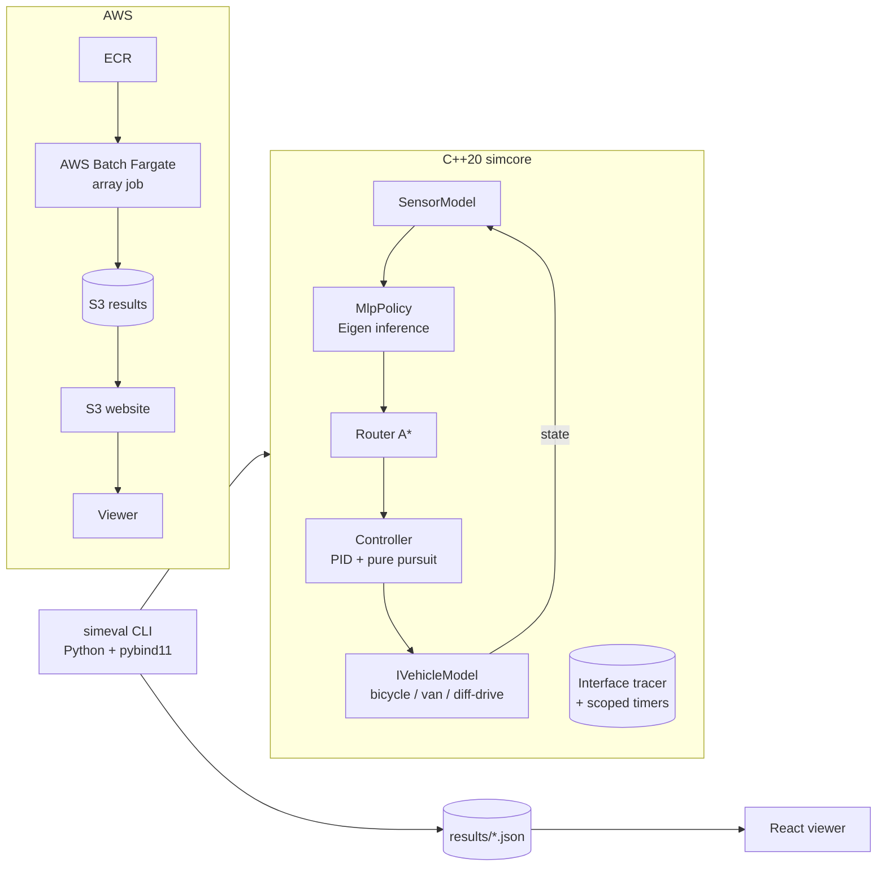

# Drive Sim Eval: a deterministic driving simulator with a scale-out evaluation pipeline

## The problem

Learned driving stacks are judged by how they behave in simulation, so the simulator has to be (1) fast enough to score thousands of scenarios, (2) exactly reproducible so a regression is a real regression, and (3) good at answering the question every sim team gets: *why does the simulated run differ from what the car did on the road?* Drive Sim Eval is a small but complete version of that loop.

## What it does

- A **C++20 core** runs sensors → MLP policy → A* routing → PID/pure-pursuit control → vehicle dynamics at a fixed 0.05 s timestep. **Open-loop** (replay logged states, score the policy's actions against the logged actions) and **closed-loop** (the policy drives) are one engine; the pipeline config chooses the components.
- Three platforms swap in by config only: car (kinematic bicycle), van (bicycle + 0.2 s actuator latency), robot (differential drive).
- **Python** (pybind11 wheel `simcore` + `simeval` CLI) generates 200 scenarios, runs them in a process pool, proves bit-for-bit reproducibility, traces divergence from an on-road log, and profiles each component.
- A **React viewer** shows batches, canvas replays, divergence reports, profiles and repro results from static JSON.
- The same container fans out over **AWS Batch on Fargate** (20-child array job + dependent aggregate job).

## Architecture



## Stack → requirement

| Requirement | Where | Proof |
|---|---|---|
| Modern C++ and Python in one codebase | `core/` (C++20, CMake presets, Eigen, nlohmann/json, spdlog JSON logs) + `simeval/` via pybind11 / scikit-build-core | [ctest](../proof/phase1-local/tests/ctest-junit.xml), [pytest](../proof/phase1-local/tests/pytest-junit.xml) |
| Integrate new vehicle platforms | `IVehicleModel`: bicycle, bicycle + latency, diff-drive | [car](../proof/phase1-local/screenshots/03-run-replay-car.png), [robot](../proof/phase1-local/screenshots/04-run-replay-robot.png) |
| Configurable, high-scale open-loop | `configs/*.yaml`, 200-run batch, worker scaling | [overview](../proof/phase1-local/screenshots/02-batch-overview.png), [scaling.json](../proof/phase1-local/logs/scaling.json) |
| On-road vs sim differences | Per-interface trace records, first-diverging-interface tracer | [diff](../proof/phase1-local/screenshots/05-diff-divergence.png), [injected fault](../proof/phase1-local/screenshots/08-diff-injected-dropout.png) |
| Reproducibility, testing, observability | SHA-256 trajectory digest, repro-check, JSON logs, 4 test layers | [repro](../proof/phase1-local/screenshots/07-repro-green.png) |
| Profiling | Scoped timers → Chrome Trace (Perfetto) + summary | [profile](../proof/phase1-local/screenshots/06-profile.png), [trace](../proof/phase1-local/logs/perfetto-trace.json) |
| Scale-out | ProcessPoolExecutor locally; AWS Batch Fargate array job in the cloud | [cloud overview](../proof/phase2-cloud/screenshots/01-cloud-batch-overview.png), [jobs](../proof/phase2-cloud/logs/batch-describe-jobs.json) |
| IaC, CI, containers | Terraform (AWS provider 6.x), GitHub Actions, multi-stage Docker | [resources](../proof/phase2-cloud/resources.txt), [destroy check](../proof/phase3-destroy/verify-destroyed.txt) |
| GenAI tooling with review | [AI_USAGE.md](AI_USAGE.md) | |

## Highlights

- **Determinism is a feature.** Fixed timestep, seeded `mt19937_64` with a hand-written Box-Muller normal, no wall-clock in the simulation, no FMA contraction. The digest of the canonical trajectory JSON is identical across repeats and across 1/2/4/8 workers ([scaling.json](../proof/phase1-local/logs/scaling.json)), and the 200 digests computed on AWS Batch match the local ones exactly.
- **Divergence tracing finds the right interface.** The on-road "vehicle" is the van platform. Replaying its logged commands through the car model shows `Controller→VehicleModel` matching while `VehicleModel→Sensor` diverges from tick 0: a latency/dynamics mismatch. On the van platform the replay matches the log exactly, and an injected `sensor_dropout@tick=40` is pinned to the Sensor interface at tick 40.
- **A learned policy, honestly imperfect.** A 8→32→2 MLP is trained in numpy by imitating a pure-pursuit expert on rollouts with perturbed starts, then runs in C++ with Eigen. It scores 182/200 open-loop scenarios under the error threshold and completes most closed-loop drives; a few curves fail, which the viewer shows rather than hides.
- **Throughput.** The 200-run open-loop batch completes in about 2.7 s with 8 workers (75 runs/s, 4.7× over one worker).

## What was hard

- **Making the learned policy stable in closed loop.** The first MLP drifted far off the route. Fixes: label noise-free expert targets from the same observation vector, weight curvature error 8× over speed error, replace the cusp-shaped stopping profile (`sqrt`) with a linear ramp the network can fit, and train on perturbed starts.
- **Defining "first diverging interface".** Interfaces are compared per tick within tolerance; the earliest tick wins and ties go to pipeline order, and only interfaces observable on a real vehicle (not the policy output) take part.
- **Environment friction.** No C++ toolchain on the Windows host (everything builds in Docker), Windows-generated npm lockfile failing on Linux CI, and a Windows/Docker bind-mount bottleneck that distorted the scaling benchmark until the benchmark copied scenarios to local disk.
- **CloudFront blocked.** The AWS account is not verified for CloudFront (403 on create). The viewer is served by S3 static website hosting instead; logged in [DECISIONS.md](DECISIONS.md).

## Approximate AWS cost

The stack lived for well under two hours: 20 + 1 Fargate tasks of 1 vCPU / 2 GB running a few seconds each, ~400 MB in ECR, a few hundred MB in S3, one day of CloudWatch logs, no NAT gateway. The estimate is **well under USD 1**. Everything was destroyed and verified ([verify-destroyed.txt](../proof/phase3-destroy/verify-destroyed.txt)).

## Reproduce

```bash
scripts/dev-up.sh                 # local: Docker build, seed data, viewer on :5173
scripts/test-all.sh               # ctest + ruff + pytest + vitest + playwright
scripts/capture-proof.sh phase1
scripts/deploy.sh                 # AWS: Terraform, image push, Batch array job, viewer
scripts/capture-proof.sh phase2
scripts/destroy.sh && scripts/verify-destroyed.sh
```
